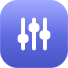
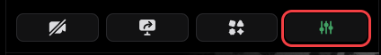
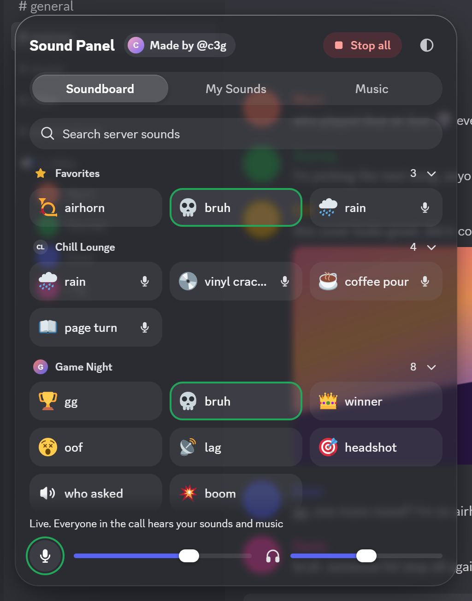
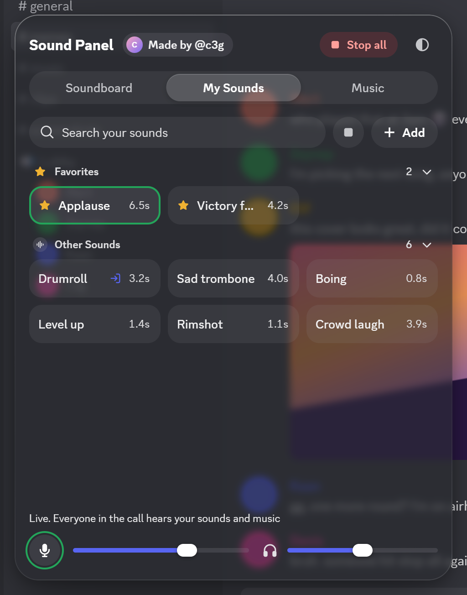
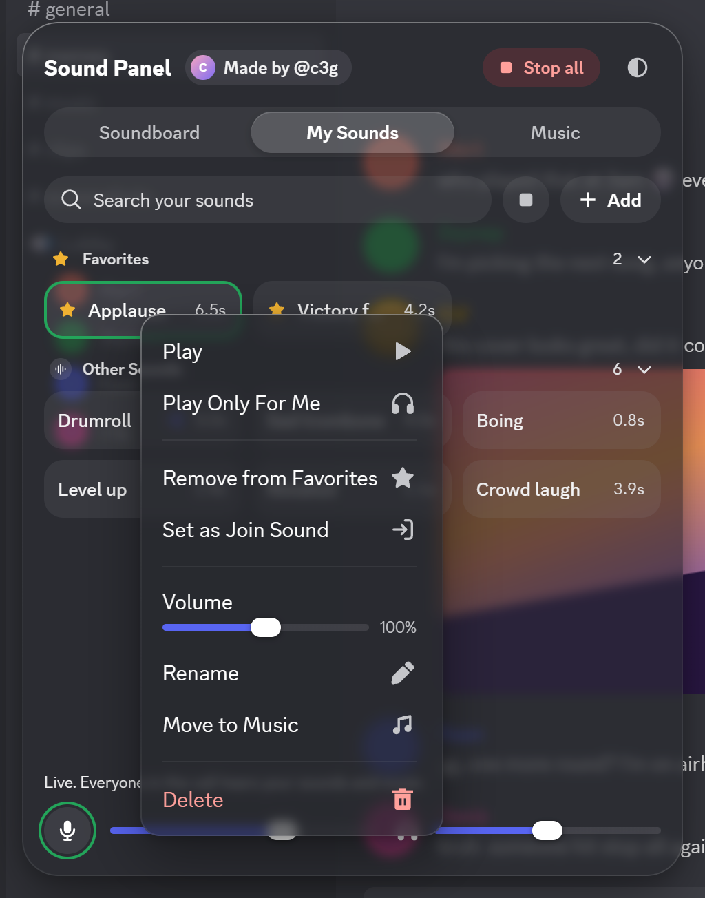
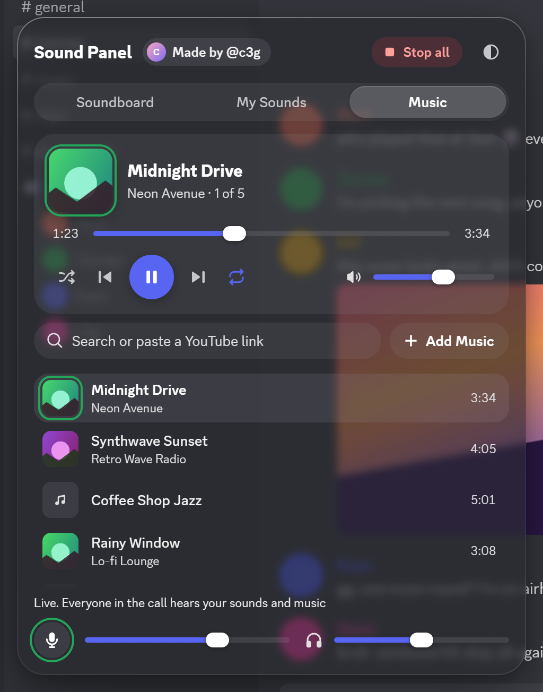
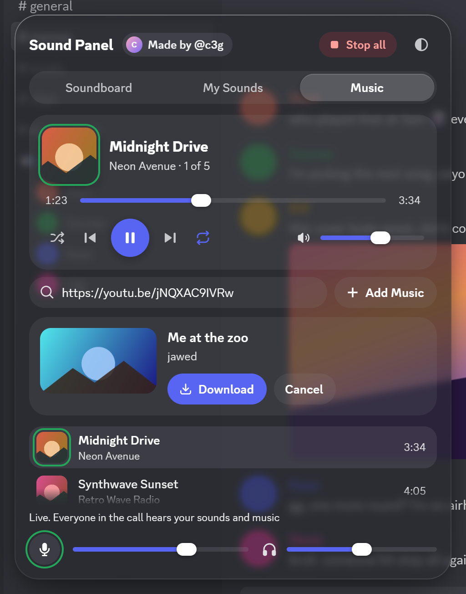

<div align="center">



# Sound Panel

**Play soundboard sounds, your own sounds and music in voice calls.**

A [Vencord](https://github.com/Vendicated/Vencord) plugin. It adds a button to your voice controls that opens a panel with every soundboard sound you can use, your own sound effects and a music player.

[](LICENSE)
[](https://github.com/Vendicated/Vencord)

</div>

## Features

| | Feature | What it does |
|:---:|---|---|
|  | **Soundboard** | Every soundboard sound you can use, grouped by server, with your favorites and a search |
|  | **Through your mic** | Plays sounds Discord won't let you play here (no permission, or another server's sound without Nitro) through your microphone, so everyone in the call still hears them |
|  | **My Sounds** | Your own sound effects, with your favorites on top. Add files, then rename them, set their volume or move them |
|  | **Join sound** | A sound of your choice plays when you join a voice channel, also without Nitro |
|  | **Music** | A playlist, newest first, with shuffle, repeat and seeking that plays into the call |
|  | **YouTube links** | Paste a YouTube link to see the video, then download it into your music. It plays while it downloads. Desktop app only |
|  | **Two volumes** | One volume for what others hear, another for what you hear |
|  | **One library** | Discord Stable, PTB and Canary share the same sounds and music |
|  | **WebRTC mode** | On the desktop app, mixes your audio into your microphone and keeps screen sharing and the camera working at full quality |

## How to use

### 1. Open the panel

Join a voice channel. The **Sound Panel** button is at the right end of the voice buttons, at the bottom left.



Use the stop button at the top right to stop everything at once. The bar at the bottom shows whether others can hear your audio, with one volume slider for them and one for you.

### 2. Play server sounds

The **Soundboard** tab has your favorites first, then each server, then Discord's default sounds. Click a sound to play it.



| You see | It means |
|---|---|
| Normal sound | Plays with Discord's soundboard, same as Discord's own button |
| Microphone badge | Plays through your microphone, because Discord's soundboard isn't allowed here |
| Headphones badge | Only you hear it. Hover it to see why |
| Green ring | It's playing, and the call hears it |
| Gray ring | It's playing, but only you hear it |

Right-click a sound to choose how it plays, preview it only for yourself, add it to your favorites, make it your [join sound](#5-set-a-join-sound) or save it to **My Sounds** or **Music**. These favorites are the same as in Discord's own soundboard.

### 3. Add your own sounds

Open **My Sounds**, click **Add** or drop audio files onto the panel, then click a sound to play it. Your newest sounds come first, and your favorites sit above them.



Right-click a sound for more:



| Option | What it does |
|---|---|
| **Play** | Plays it into the call |
| **Play Only For Me** | Plays it only on your speakers |
| **Add to Favorites** | Moves it to the favorites at the top |
| **Set as Join Sound** | Plays it when you join a voice channel |
| **Volume** | Makes this sound louder or quieter, up to 200% |
| **Rename** | Changes its name |
| **Move to Music** | Moves it to your playlist |
| **Delete** | Removes it from your library |

### 4. Play music

Open **Music**, click **Add Music** or drop files, then click a track. Your newest songs are at the top. You can shuffle, repeat the list or one track, seek and change the music volume.



To play a song from YouTube, copy its link and paste it into the search box. A card shows the video's thumbnail, title and channel, and nothing downloads until you click **Download**. Then the song starts playing after a few seconds while it downloads in the background. It waits at the top of your playlist with a progress bar, and you can keep browsing, play other tracks or paste more links. Once saved, it stays in your music with its cover and channel name, and its link's card shows **Play** instead of **Download**. Right-click the song to open the video on YouTube. The first time, the plugin also downloads the two tools it needs, about 24 MB.



### 5. Set a join sound

Right-click a sound in **Soundboard** or **My Sounds** and choose **Set as Join Sound**. It plays once when you join or switch to a voice channel on a server, and a small arrow-in-a-door badge marks it. Choose **Remove Join Sound** in the same menu to turn it off.

- A soundboard sound plays with Discord's soundboard, as if you clicked it. A sound from another server needs Nitro there, or it plays through your microphone.
- Your own sounds play through your microphone, so on the desktop app others hear them only with **Webrtc Engine** on.
- It stays quiet while you're muted, and reconnecting to the same channel doesn't play it again.

## Letting others hear your own sounds

Discord's soundboard sounds need nothing extra. The plugin mixes your own sounds and music into your microphone, and that needs Discord's WebRTC voice engine:

- **Browser and Vesktop**: they already use it.
- **Desktop app**: turn on **Webrtc Engine** in the plugin settings, then quit Discord from the system tray and open it again.

In WebRTC mode on the desktop app:

- Discord encodes your video with VP8 on your processor, because the desktop app can't encode H264 in this mode.
- **Max Video Quality** (on by default) sends your camera and streams at full quality instead of shrinking them to each viewer's window size.
- The plugin keeps the call's own sound out of your stream audio, so nobody hears an echo of themselves.
- Krisp noise suppression filters out music. Turn it off when you play music.
- Discord builds video backgrounds (blur and images) into its native engine, so the option is missing in this mode.

## Settings

Open them from **Vencord → Plugins → SoundPanel**.

| Setting | Default | What it does |
|---|:---:|---|
| **Transmit** | On | Sends your sounds and music to the call. When off, only you hear them |
| **Voice Volume** | 100% | How loud others hear your sounds and music, up to 150% |
| **Local Volume** | 50% | How loud you hear your sounds, music and previews |
| **Music Volume** | 60% | Music volume, for you and everyone in the call |
| **Server Sounds Through Mic** | Off | Plays server sounds through your microphone even where Discord's soundboard is allowed |
| **Allow Overlap** | On | Lets your sounds play over each other. When off, clicking a playing sound stops it |
| **Hold Push To Talk** | On | Keeps transmitting while your audio plays, if you use Push to Talk |
| **Webrtc Engine** | Off | Desktop app only. Lets others hear your own sounds and music. Needs a restart |
| **Max Video Quality** | On | Desktop app in WebRTC mode only. Sends your camera and streams at full quality |
| **Transparency** | 65% | How see-through the panel is, from 0% (solid) to 100%. You can also change it from the half-filled circle next to the panel's title |

## Installation

> [!IMPORTANT]
> This is a **user plugin**, so it is not part of the regular Vencord download. You have to build Vencord yourself once.
> Official guide: [Installing custom plugins](https://docs.vencord.dev/installing/custom-plugins/)

You need [Git](https://git-scm.com/downloads), [Node.js](https://nodejs.org/) and [pnpm](https://pnpm.io/installation).

**1.** Download Vencord *(skip if you already have it)*

```sh
git clone https://github.com/Vendicated/Vencord
cd Vencord
pnpm install --frozen-lockfile
```

**2.** Add the plugin

```sh
cd src/userplugins
git clone https://github.com/cegged/Sound-Panel
cd ../..
```

**3.** Build and install into Discord

```sh
pnpm build
pnpm inject
```

**4.** Restart Discord and turn on **SoundPanel** in **Vencord → Plugins**. On the desktop app, also turn on **Webrtc Engine** and restart once more.

### Updating

```sh
cd Vencord/src/userplugins/Sound-Panel
git pull
cd ../../..
pnpm build
```

Then restart Discord.

## FAQ

<details>
<summary><b>Others can't hear my own sounds or music</b></summary>
<br>

Check the bar at the bottom of the panel for the reason. On the desktop app you need **Webrtc Engine** on and a restart, you may be muted, or **Transmit** may be off.

</details>

<details>
<summary><b>Others see me speaking all the time</b></summary>
<br>

Discord's WebRTC engine decides you're speaking by loudness alone, so quiet background noise can count. In **Voice & Video**, turn on automatic input sensitivity, or drag the sensitivity slider to the right until the bar only lights up when you talk.

</details>

<details>
<summary><b>A server sound says only I will hear it</b></summary>
<br>

Hover the sound to see why. Most of the time you're not in a voice channel, or you're muted. Sounds you can't play with Discord's soundboard play through your microphone instead, which on the desktop app needs WebRTC mode.

</details>

<details>
<summary><b>Where are my sounds and music saved?</b></summary>
<br>

On your computer only. The desktop app keeps them in `%APPDATA%\Vencord\SoundPanel` on Windows, shared by Stable, PTB and Canary. In a browser they stay in that browser's storage.

</details>

<details>
<summary><b>How do YouTube links work?</b></summary>
<br>

The plugin downloads the song's audio with [yt-dlp](https://github.com/yt-dlp/yt-dlp), which needs a JavaScript engine to get past YouTube's checks. The first time you add a link, the plugin downloads yt-dlp and the engine [QuickJS-NG](https://github.com/quickjs-ng/quickjs) from their official GitHub releases, checks them against their published checksums and keeps them in `%APPDATA%\Vencord\SoundPanel\tools`. If [Node.js](https://nodejs.org/) 20 or newer is installed, yt-dlp uses it instead, and songs start about 3 seconds sooner. When YouTube changes something and downloads stop working, the plugin updates yt-dlp and tries again.

The plugin picks YouTube's Opus audio, about 1 MB per minute, which can play while it downloads. A few videos have no Opus audio; those start once the download finishes. You can add songs up to an hour long and 100 MB. Discord in a browser can't run these tools, so YouTube links need the desktop app.

YouTube's terms only allow downloads where YouTube shows its own download button, and the songs you play to others may be copyrighted. What you play is up to you.

</details>

<details>
<summary><b>A YouTube link doesn't work</b></summary>
<br>

Read the message the panel shows. YouTube sometimes asks you to prove you're not a bot, and some videos are private or blocked in your country. Some antivirus programs also mistake yt-dlp for a threat; allow it if you trust it.

</details>

<details>
<summary><b>Why is there no video background option?</b></summary>
<br>

Discord only has video backgrounds in its native voice engine. In WebRTC mode the option doesn't exist, so Discord hides it. Turn off **Webrtc Engine** and restart if you need it.

</details>

---

<div align="center">

Made by **cegged** · [GitHub](https://github.com/cegged) · Discord `@c3g`

Found a bug or have an idea? [Open an issue](https://github.com/cegged/Sound-Panel/issues)

Licensed under [GPL-3.0-or-later](LICENSE)

</div>
